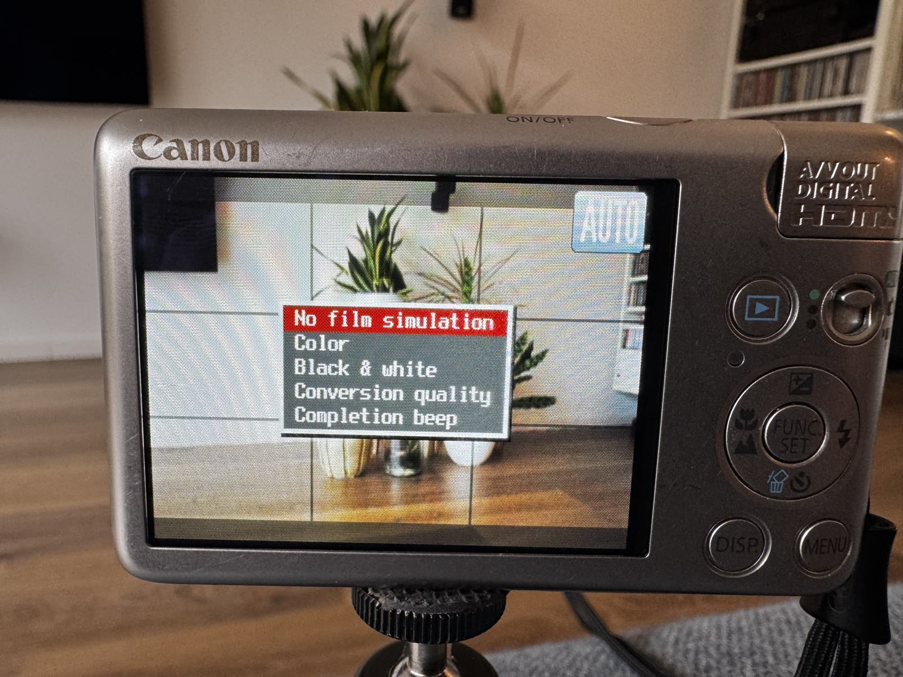
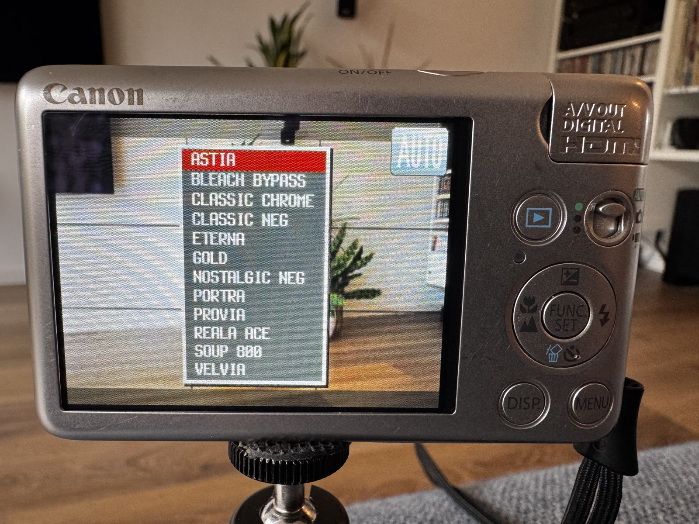
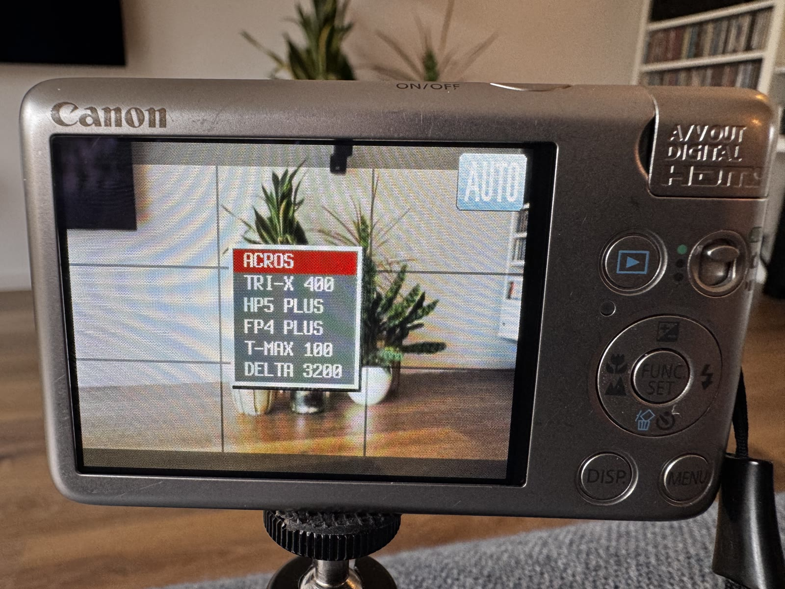
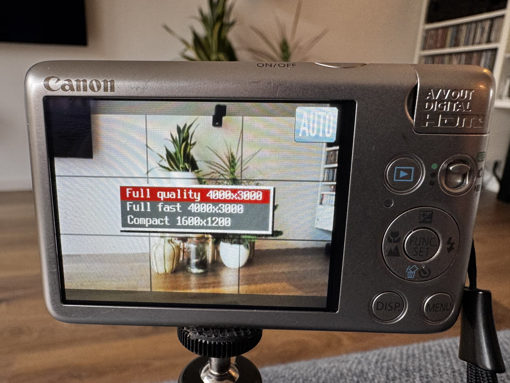
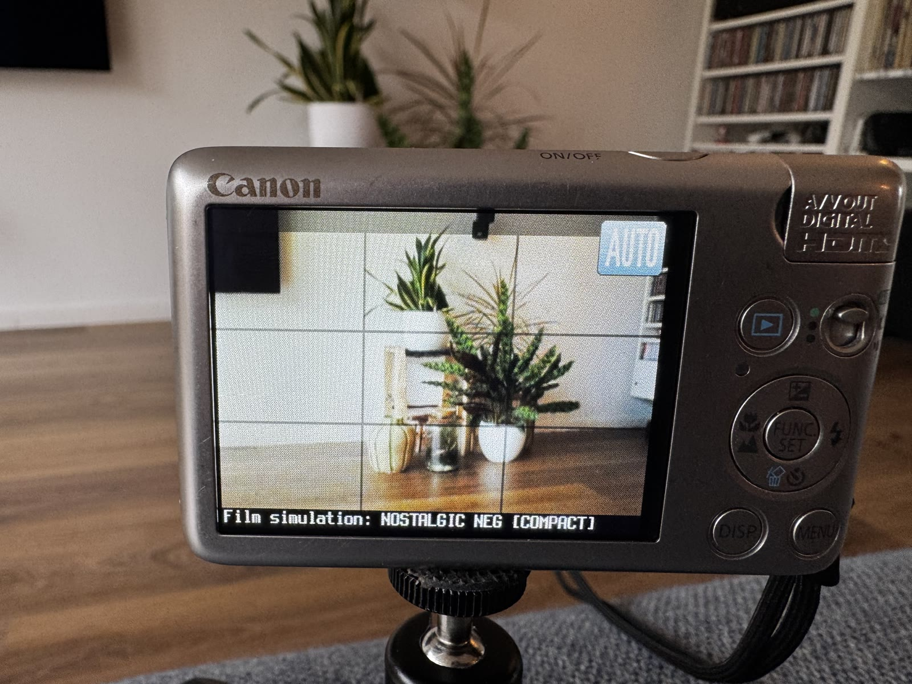
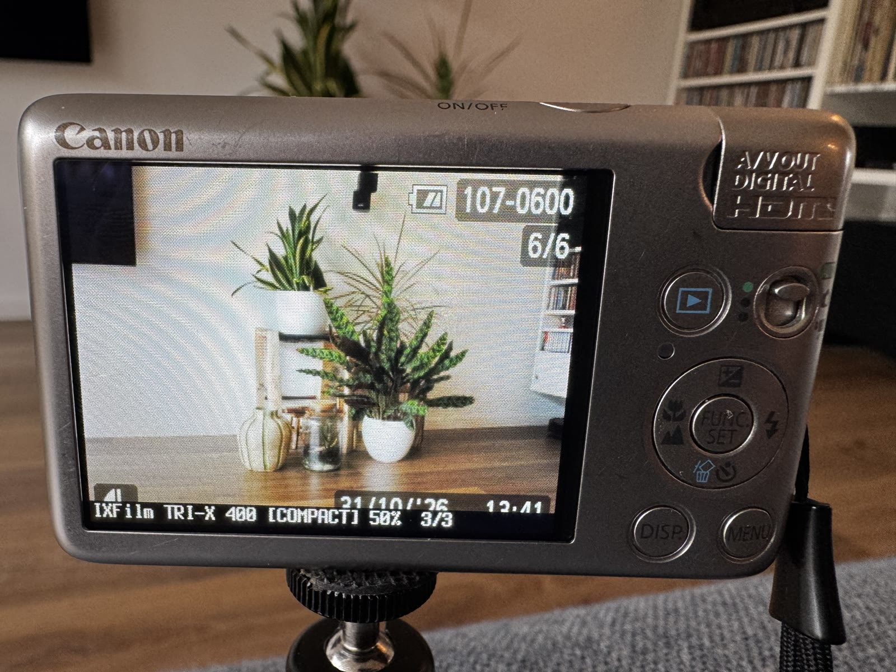
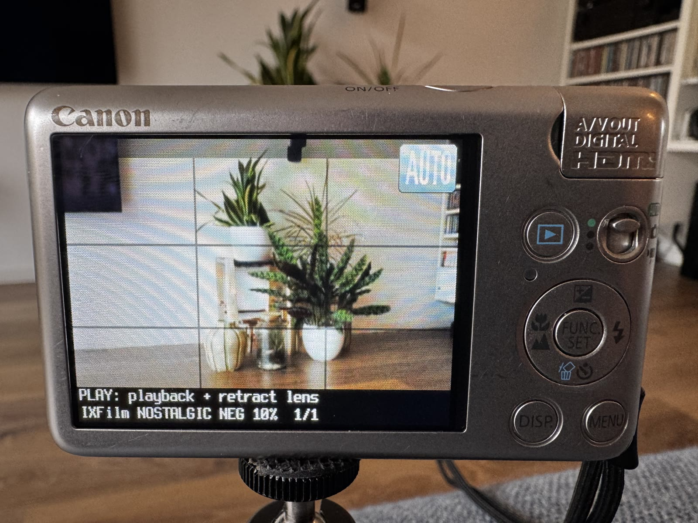
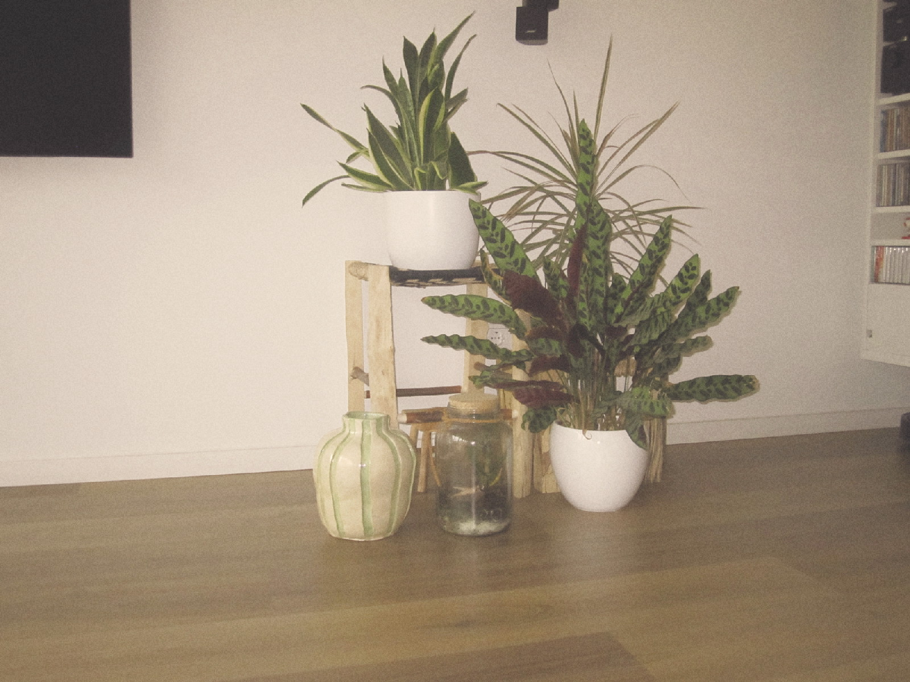
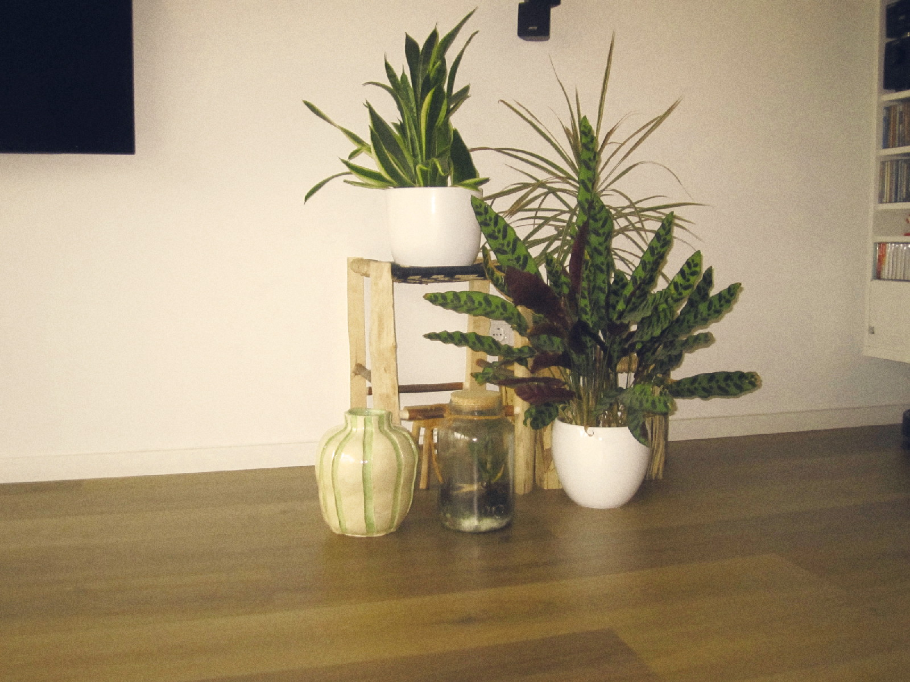
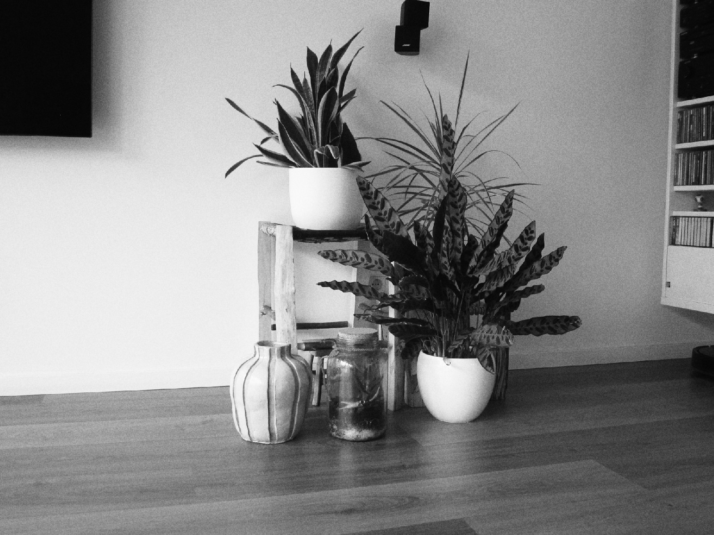

# IXFilm OS

Film simulations for a Canon IXUS 120 IS, processed directly on the camera.

IXFilm OS watches the JPEGs the camera writes, develops a version with the selected film look and puts that version back on the SD card. Hold `DISP` to open the menu. The normal Canon controls remain normal Canon controls, which turned out to be a surprisingly ambitious feature.

This is not replacement firmware and it does not flash the camera. It is a heavily stripped and modified CHDK build that runs from a locked SD card. Remove or unlock that card and the camera is back to stock.

## Why this exists

For shits and giggles, mostly.

The sensible way to give photographs a film look is to use a modern camera, a phone or a computer that can finish the job before you have forgotten taking the picture. IXFilm instead asks a 2009 compact camera to decode, process and rewrite its own JPEGs with very little memory and no particular sense of urgency.

That is not especially practical. It is, however, rather satisfying. The point of the project is to see how far this tiny camera can be pushed while keeping the normal Canon interface intact. If it also makes an old camera fun to carry again, all the better.

## What works

- A film simulation menu opened by holding `DISP`.
- Separate colour and black-and-white lists.
- Twelve colour looks and six black-and-white looks.
- The selected look survives a restart and stays visible in the shooting display.
- Compact conversion at 1600 x 1200.
- Two 4000 x 3000 conversion modes.
- A queue when you take another photograph before the previous one has finished.
- An optional beep after each conversion.
- UI text that follows every language offered by the European 1.00E firmware. Languages that the built-in font cannot render use readable ASCII transliteration.

## The honest bit

IXFilm runs on a tiny camera from 2009. Conversion is not quick. Compact conversion takes long enough to inspect your surroundings, reconsider the composition and perhaps make tea. Full-resolution conversion takes even longer.

If you take a photograph now and then, that is mostly irrelevant. The camera works through its queue in the background. If you want to rattle off photographs all afternoon, you may prefer not to involve an antique compact camera in your workflow.

Conversion also uses noticeably more battery than normal shooting. IXFilm keeps the processor and SD card busy and prevents automatic power-off while work is still queued. Compact mode is the least demanding; full-resolution conversions keep the camera awake for much longer. Start those with a reasonably charged battery, unless you enjoy adding suspense to image processing.

## Compatibility

The current build is only for:

- Canon IXUS 120 IS
- Canon PowerShot SD940 IS
- Canon IXY DIGITAL 220 IS
- Canon firmware 1.00E

Do not try this build on another camera or firmware version. Similar names do not count.

Compact conversion is the best-tested mode. The two full-resolution modes are available but still experimental.

## Use at your own risk

IXFilm is unofficial software for old hardware. It does not flash the camera, and unlocking or removing the SD card returns the camera to its normal firmware. Even so, bugs can lose or corrupt photographs, flatten a battery at an inconvenient moment or leave the camera needing a restart. Keep another copy of anything important and do not use IXFilm for photographs that cannot be repeated.

## Installing

Start with [the installation guide](docs/INSTALL.md). It covers Windows, macOS and Linux, cards up to 4 GB and larger cards.

The easiest route is the ready-to-write 4GB card image attached to each release. Write the image to an empty SD card, lock the card and put it in the camera. No temporary CHDK installation is needed because the image already contains the bootable FAT16 layout.

The image erases the entire target card. Use a card sold as 4GB or larger. A larger card will work, but the space beyond the 2GB IXFilm partition remains unused unless you repartition it yourself. That is not much of a sacrifice on a twelve-megapixel camera from 2009.

The short version is that this older Canon can only autoboot from FAT16. A card up to 4 GB can use one FAT16 partition. A larger card needs a small FAT16 boot partition and a large FAT32 photo partition.

## Using IXFilm

1. Turn the camera on normally.
2. Hold `DISP` to open the IXFilm menu.
3. Choose colour or black and white, then choose a look with `FUNC./SET`.
4. Take a photograph.
5. Let the little processor do its very best.

After a successful conversion, the film-simulated JPEG replaces the original Canon JPEG under the same filename. If conversion fails, IXFilm removes its temporary output and leaves the original photograph intact. If you want an original-and-converted comparison, take a separate frame with film simulation disabled.

### Colour and black and white

The menu keeps the two lists separate. This saves scrolling and, more importantly, prevents eighteen names from becoming a very small typographic endurance test.

| Colour simulations | Black-and-white simulations |
|---|---|
|  |  |

### Conversion quality

Compact is the practical default. The full-resolution modes ask considerably more of a processor that was already middle-aged when some current cameras were born.

Some real timings from the camera used to develop IXFilm:

| Mode | Resolution | Observed conversion time |
|---|---:|---:|
| Compact | 1600 x 1200 | 46 seconds to 1 minute 36 seconds |
| Full fast | 4000 x 3000 | about 6 minutes |
| Full quality | 4000 x 3000 | about 7 minutes 36 seconds |

These are practical measurements from a small set of photographs, not laboratory benchmarks. Processing time varies with the selected recipe and the contents of the image. Full resolution really does mean full resolution, but the camera would like you to clear the rest of your afternoon first.

### Status and queue

The selected simulation remains visible in the shooting display. During conversion, the same area shows progress and the current position in the queue.

| Ready to shoot | Working through a queue |
|---|---|
|  |  |

While a conversion is active, IXFilm also explains how to retract the lens without stopping the work:

### Putting the camera away during conversion

In the Canon menu, set **Lens retract** to **0 sec.** This is a manual, one-time setting and IXFilm deliberately does not change it.

While a conversion is running, press `PLAY`. The camera enters its native playback mode and retracts the lens. The conversion can continue with the lens safely inside the body. You can then put the camera in a pocket without using the lens as an accidental coat hook.

## Photographs

These are converted by IXFilm inside the camera. The linked files are the complete JPEGs written to the SD card, without resizing for the repository.

| Nostalgic Neg, Compact | Gold, Compact | Tri-X 400, Compact |
|---|---|---|
|  |  |  |

The [sample-photo folder](docs/sample-photos) also contains the full 4000 x 3000 output from Full fast and Full quality.

## Credits and licence

IXFilm OS is built on [CHDK](https://github.com/CHDK/chdk) and uses the GPL-licensed [Soup Engine](https://github.com/jiijii0/soup-engine) image-processing code. The film recipes are original approximations, not measured reproductions of commercial film stocks. Product names and trademarks belong to their owners.

The complete project is distributed under the GNU General Public License version 2. See the [licence text](chdk-trunk/COPYING) and [CREDITS.md](CREDITS.md).

This is unofficial software for old hardware, supplied without warranty. Back up your photographs before experimenting.

